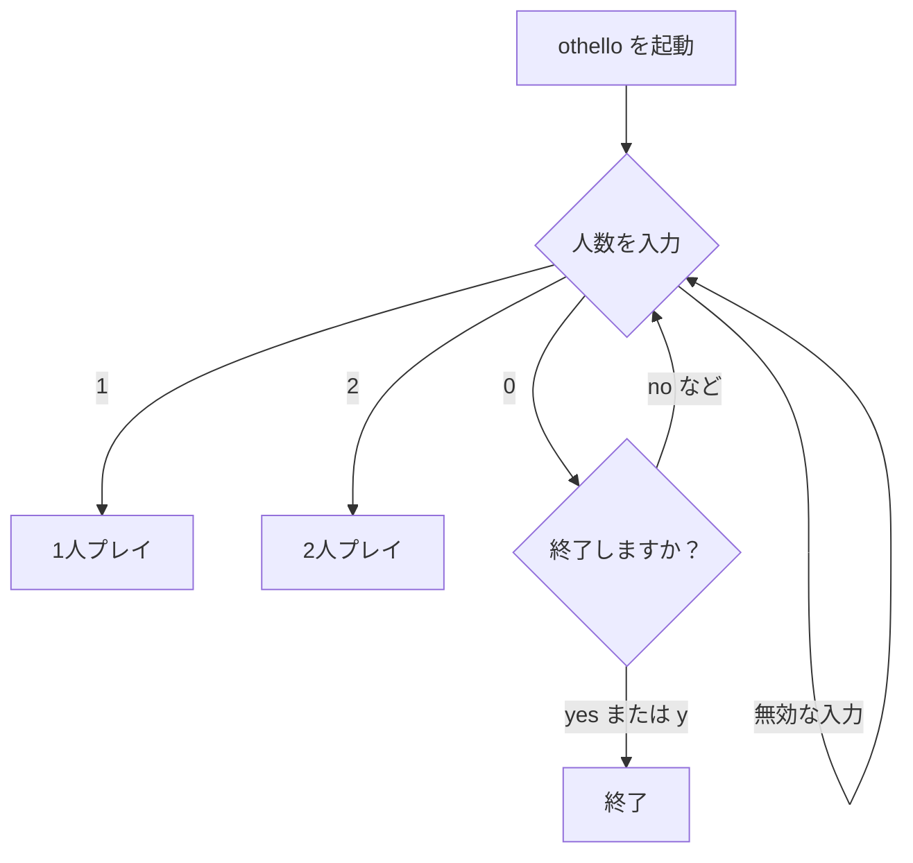
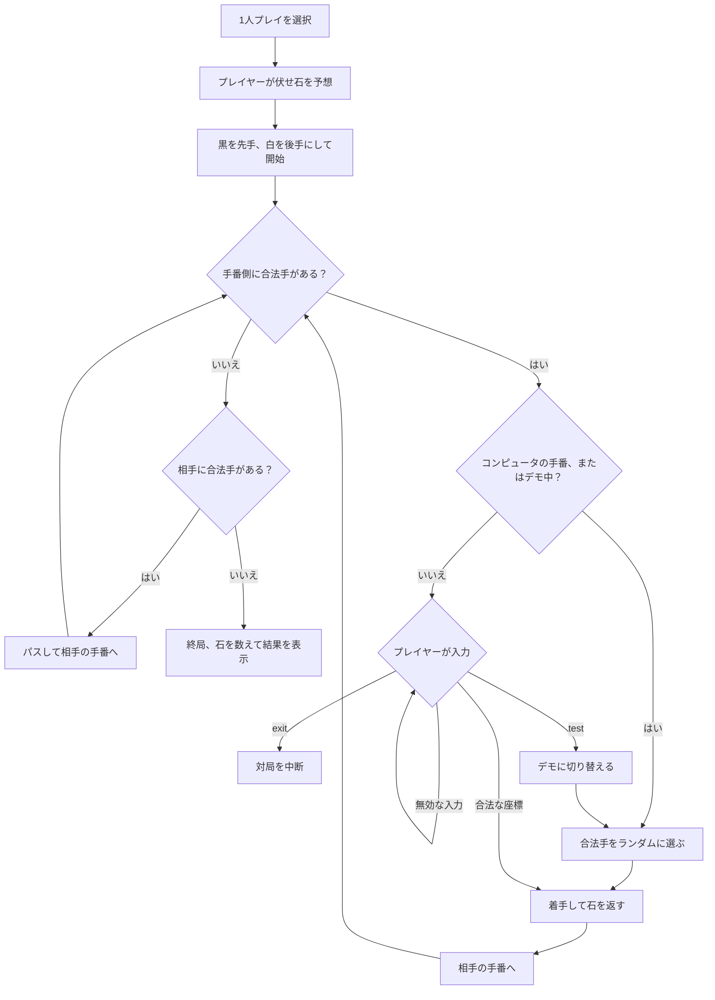
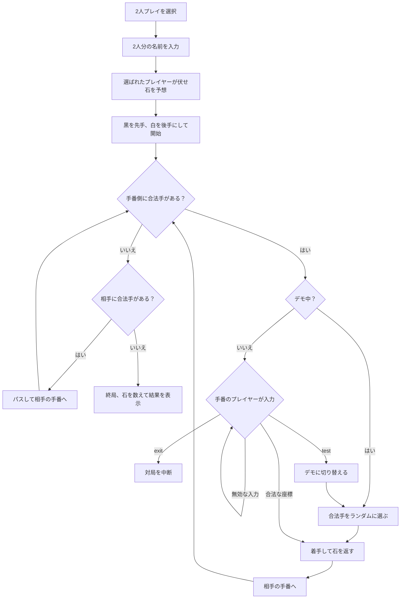

# CLI_othello_game_for_C-lang

[English](README.md)

Unix系のターミナルで遊べる、C製のオセロゲームです。8×8の盤面で、コンピュータと対戦する1人プレイと、同じ端末を交代で使う2人プレイに対応しています。

## インストール

必要なものは Git、`make`、`-std=gnu23` に対応するCコンパイラ（GCC 14など）、日本語と盤面の記号を表示できるUTF-8端末です。Debian 13では、必要なツールを次のコマンドで導入できます。

```sh
sudo apt install git make gcc-14
```

ソースを取得し、リポジトリのディレクトリに移動します。

```sh
git clone https://github.com/masamarsa/CLI_othello_game_for_C-lang.git
cd CLI_othello_game_for_C-lang
```

## ビルド

リポジトリの直下で次のコマンドを実行します。

```sh
make
./othello
```

`make` は既定で `cc` を使います。`gcc-14` を明示するには `make CC=gcc-14` を実行します。ビルド済みの場合は先に `make clean` で実行ファイルとオブジェクトファイルを削除します。

ビルドした実行ファイルを自分のアカウントにインストールする場合は、次のようにコピーします。`~/.local/bin` が `PATH` に含まれていれば、どのディレクトリからでも `othello` で起動できます。

```sh
mkdir -p "$HOME/.local/bin"
install -m 755 ./othello "$HOME/.local/bin/othello"
```

## 遊び方

起動したら、`1` でコンピュータと対戦、`2` で2人対戦を選びます。各入力は Enter で確定します。対局前に終了するには、人数選択で `0` を入力し、確認に `yes` または `y` と答えます。

どちらのモードでも、伏せ石の黒面が上（`0`）か下（`1`）かを予想します。当てた側、外れた場合は相手側が黒の先手です。

### モード選択のフローチャート



### 盤面と着手

- 列は `a` ～ `h`、行は `1` ～ `8` です。たとえば `d3` は列 `d` の3行目を表します。
- 盤面では黒石を `○`、白石を `●` で表示します。人が操作する手番では、石を置けるマスに `.` が表示されます。
- 縦・横・斜めに相手の石を自分の石で挟めるマスに置くと、挟んだ石がすべて自分の色に変わります。置けない座標を入力した場合は、同じ手番で入力し直します。
- 合法手がない側は自動でパスします。両者とも置けなくなった時点で終局し、盤上の石が多い側の勝ちです。同数なら引き分けです。
- 着手入力で `exit` を入力すると対局を中断します。`test` を入力するとデモに切り替わり、その手から終局まで両者が合法手をランダムに選びます。

### 1人プレイのフローチャート

プレイヤーが伏せ石を予想します。コンピュータは自分の手番になると、合法手からランダムに選んで着手します。



### 2人プレイのフローチャート

2人分の名前を順に入力します。日本語とローマ字が使えます。名前は空白を含まない79バイト以内で入力してください。伏せ石を予想する人はランダムに選ばれます。



## ソース構成

- 対局の進行、パス、自動着手（[othello.c](othello.c)）
- 盤面、合法手の探索、石の反転と集計（[board.c](board.c)、[board.h](board.h)）
- 対局設定、入力の検証、盤面と結果の表示（[console.c](console.c)、[console.h](console.h)）
