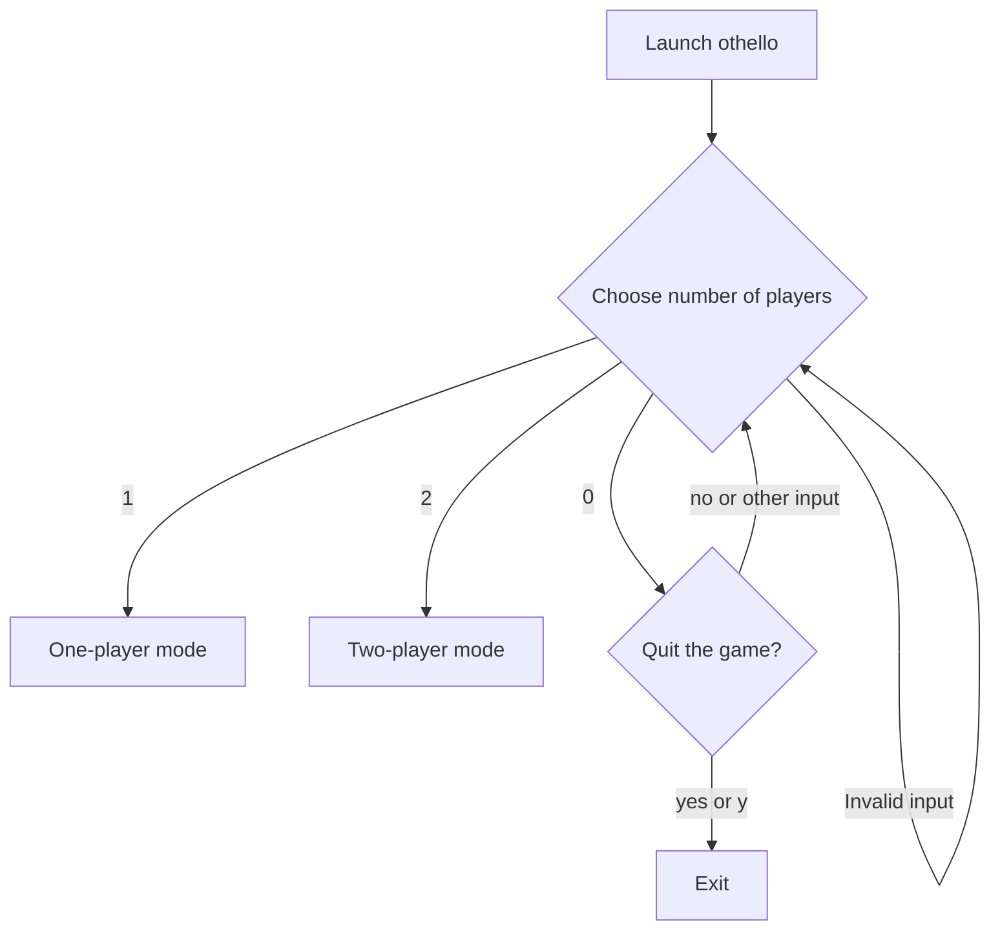
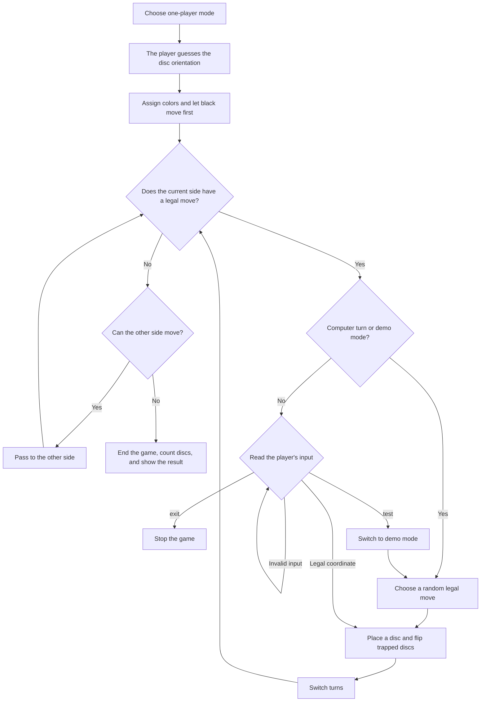
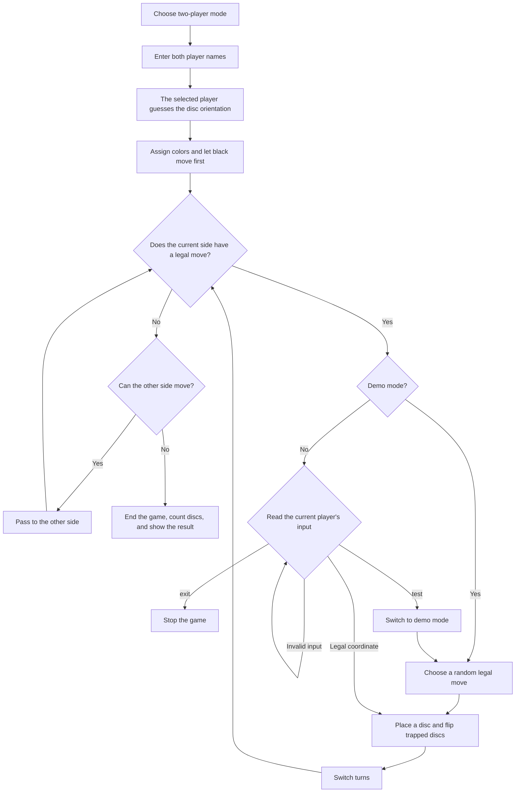

# CLI_othello_game_for_C-lang

[日本語版](README.ja.md)

A command-line Othello game written in C for Unix-like systems. Play on an 8×8 board against the computer or take turns with a second player in the same terminal. The game prompts are in Japanese.

## Installation

You need Git, `make`, a C compiler that supports `-std=gnu23` (such as GCC 14), and a UTF-8 terminal that can display Japanese text and board symbols. On Debian 13, install the required tools with:

```sh
sudo apt install git make gcc-14
```

Clone the repository and enter its directory.

```sh
git clone https://github.com/masamarsa/CLI_othello_game_for_C-lang.git
cd CLI_othello_game_for_C-lang
```

## Build and run

From the repository root, run:

```sh
make
./othello
```

The Makefile uses `cc` by default. To select GCC 14 explicitly, run `make CC=gcc-14`. If you have already built the game, run `make clean` first to remove the executable and object files.

To install the executable for your user account, copy it with the commands below. If `~/.local/bin` is on your `PATH`, you can then run `othello` from any directory.

```sh
mkdir -p "$HOME/.local/bin"
install -m 755 ./othello "$HOME/.local/bin/othello"
```

## How to play

At startup, enter `1` to play against the computer or `2` to play with a second person. Press Enter to submit each input. To quit before starting a game, enter `0` at the mode prompt and confirm with `yes` or `y`.

In both modes, one player guesses whether the black face of a hidden disc is up (`0`) or down (`1`). A correct guess gives that player black and the first turn. An incorrect guess gives black to the other side.

### Mode selection flowchart



### Board and moves

- Columns run from `a` to `h` and rows from `1` to `8`. For example, `d3` means column `d`, row `3`.
- The board displays black discs as `○` and white discs as `●`. On a human turn, a `.` marks each legal move.
- Place a disc so that it traps one or more opposing discs between two of your own discs in a straight line, horizontally, vertically, or diagonally. All trapped discs flip to your color. If you enter an illegal move, you can try again on the same turn.
- A side with no legal moves passes automatically. The game ends when neither side can move. The side with more discs wins, and equal counts are a draw.
- At the move prompt, enter `exit` to stop the game or `test` to switch to demo mode. In demo mode, both sides choose random legal moves from that turn until the game ends.

### One-player flowchart

You guess the hidden disc's orientation. On each of its turns, the computer chooses a legal move at random.



### Two-player flowchart

Enter both player names in order. Names can use Japanese or Latin characters and must be at most 79 bytes, with no spaces. The game randomly picks which player guesses the disc's orientation.



## Source layout

- Game flow, passes, and automatic moves ([othello.c](othello.c))
- Board state, legal moves, disc flipping, and scoring ([board.c](board.c), [board.h](board.h))
- Game setup, input validation, and terminal display ([console.c](console.c), [console.h](console.h))
